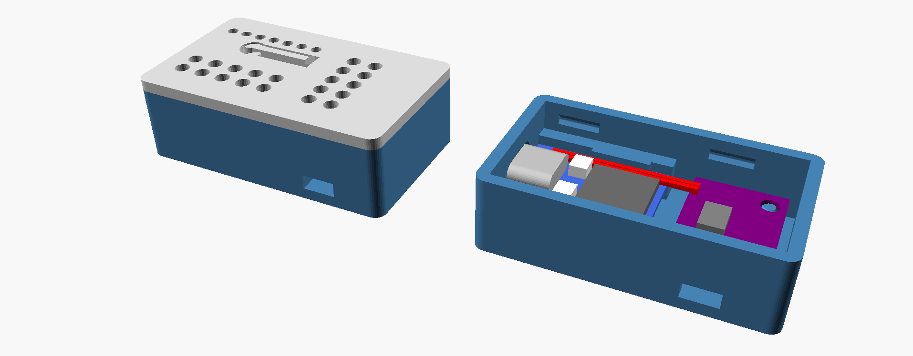
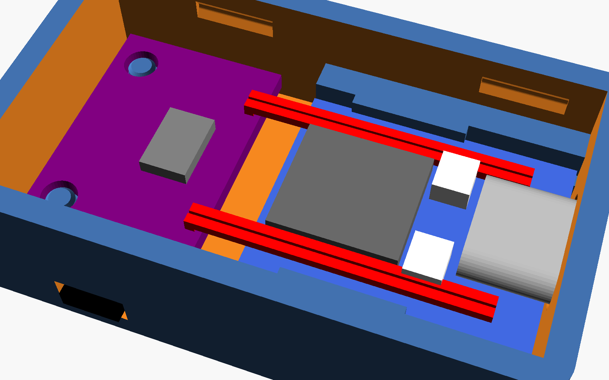
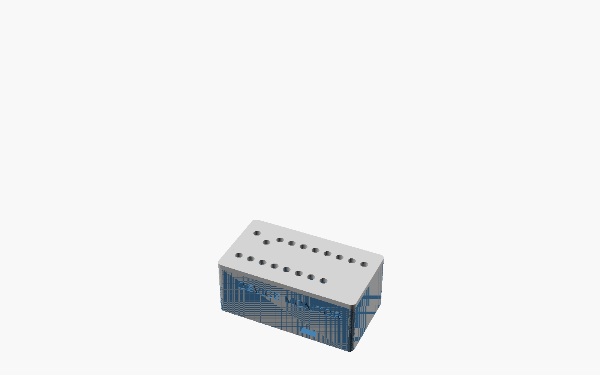

 

# Device Monitor

A small box that tells you whether a machine is **on or off** by feeling its
vibration: a sump pump, washer, dryer, AC compressor, well pump, dehumidifier.
An ESP32-C3 SuperMini reads an ADXL346 (or ADXL345) accelerometer and reports
every start and stop, with the run length, to whichever of these you use:

- **Web page on the board** (always on): live state, calibration, settings, log.
- **Home Assistant** over MQTT, found automatically (MQTT Discovery). Enables device status voice alerts on smart speakers.
- **ntfy** push notifications to your phone.
- **InfluxDB** (directly or through Telegraf) with a ready-made **Grafana** dashboard.

Everything except the web page is optional and stays off until you configure it.
One firmware image serves every unit: each board's name, Wi-Fi, calibration and
connections are set at run time, not compiled in.

It is the simple sibling of [Sump Master 2000](https://github.com/bradrblack/sump-master-2000)
(which adds water level, temperature and humidity): the same detection algorithm,
reliability code, web page, OTA and outputs, cut down to on/off. The Wi-Fi setup
portal and the case style come from the
[RF ceiling fan remote](https://github.com/bradrblack/rf-ceiling-fan-remote).

**Contents:** [Building a new unit](#building-a-new-unit) ·
[Hardware](#hardware) · [Carrier PCB](#carrier-pcb) · [Case](#case) ·
[Firmware](#firmware) · [First boot and Wi-Fi](#first-boot-and-wi-fi) ·
[Naming the device](#naming-the-device) · [Calibration](#calibration) ·
[Home Assistant](#home-assistant) · [ntfy](#ntfy-notifications) ·
[InfluxDB and Grafana](#influxdb-and-grafana) · [Web page](#web-page) ·
[Updating firmware](#updating-firmware) · [How detection works](#how-detection-works) ·
[Reliability](#reliability) · [Notes](#notes-and-gotchas)

## Building a new unit

The whole path from parts to a calibrated unit on your network:

1. **Pick a case and print it**: [Case](#case). The slide-in case (recommended)
   needs only four soldered wires. The PCB case needs the
   [Carrier PCB](#carrier-pcb) ordered and assembled first.
2. **Wire or assemble the electronics** for that case.
3. **Flash the firmware over USB** (once): [Firmware](#firmware).
4. **Join it to Wi-Fi and name it** with the setup portal from your phone:
   [First boot and Wi-Fi](#first-boot-and-wi-fi).
5. **Close the case and mount it** on the machine (or its pipe), firmly.
6. **Calibrate** on its web page, `http://<name>.local/`: [Calibration](#calibration).
7. **Connect the outputs** you want, on the same page:
   [Home Assistant](#home-assistant), [ntfy](#ntfy-notifications),
   [InfluxDB and Grafana](#influxdb-and-grafana).

After that, updates go over Wi-Fi: [Updating firmware](#updating-firmware).

## Hardware

| Part | Qty | Notes |
|---|---|---|
| ESP32-C3 SuperMini | 1 | The "v2" with an external antenna and an RGB LED on GPIO 8 is the default. An older one with a plain blue LED works too; build `devmon-plain-led` |
| GY-346 module (ADXL346 accelerometer) | 1 | |
| Printed case (tray and lid) | 1 | [Case](#case): slide-in or PCB |
| Thin wire, 26-30 AWG | 4 x 35 mm | Slide-in case only |
| Carrier PCB | 1 | PCB case only: [Carrier PCB](#carrier-pcb) |
| 100-470 µF electrolytic capacitor | 1 | PCB case only, optional: across 3V3/GND next to the accelerometer (max 8 x 12.5 mm, 2.5 mm pitch) |
| USB-C cable and a 5 V USB power supply | 1 | Any phone charger |

**Pins** (the same for both cases):

| Signal | ESP32-C3 | Notes |
|---|---|---|
| Accelerometer SDA | GPIO 5 | I2C at 100 kHz |
| Accelerometer SCL | GPIO 6 | |
| Status LED | GPIO 8 | the SuperMini's own LED |
| 3V3 / GND | 3V3 to VIN, GND to GND | |

GPIO 2, 8 and 9 are boot strapping pins on the C3, so nothing else uses them.

**ADXL345 or ADXL346:** the firmware reads the chip's device ID at boot (0xE5 =
ADXL345, 0xE6 = ADXL346) at either I2C address (0x53 or 0x1D) and uses whichever
it finds; the web page and boot log say which. The two chips are
register-compatible but **not pin-compatible**, and both cases are shaped for the
GY-346 module. An ADXL345 breakout (e.g. GY-291 or Adafruit's) still works
if you wire it by hand to the pins above (VCC to 3V3, CS to 3V3, SDO to GND), as
on the original bench build ([photo](v-sense.jpg)), but it won't fit either case.

**I2C reliability:** keep the connections short (and fit the bulk capacitor on the carrier). On the
Sump Master bench, long jumper wires without a capacitor made the sensor drop out
and the board sometimes crash in the I2C driver on a cold power-up.

## Carrier PCB

Only needed for the PCB case. A 50.5 x 24 mm two-layer carrier holds the SuperMini and the GY-346 module, plus
the bulk capacitor. It is a cut-down of the Sump Master 2000 carrier (same ESP32
and accelerometer placement, same I2C wiring). All parts are through-hole. Three
optional solder jumpers on the back ship open: INT1 to GPIO 4 (not used by this
firmware), CS to 3V3 and SDO to GND (force I2C mode and address 0x53 if a module
misbehaves).

The KiCad project, Gerbers, BOM, assembly steps and the dimensions the case is
built around are in **[hw/PCB.md](hw/PCB.md)**. Upload
`hw/devmon_carrier-v1.0-gerbers.zip` to any PCB fab as a basic 2-layer, 1.6 mm order.

## Case

 

Two printed cases, both a tray and a lid that click together with no screws and
clamp the accelerometer firmly so it feels the machine:

- **Slide-in case (recommended), 46 x 28 x 15 mm.** No PCB. The SuperMini slides
  into grooves in the walls with its USB-C in the end wall, and the GY-346 sits on
  rails and two pins. Four wires join them (3V3 to VIN, GND, GPIO 5 to SDA, GPIO 6
  to SCL). A flex tab in the lid presses RESET, a row of holes shows the LED, and
  the ribbon antenna sticks to the lid ceiling. Print `hw/case/slide_tray.stl` and
  `hw/case/slide_lid.stl`.
- **PCB case, 56 x 31 x 23 mm.** For the [carrier PCB](#carrier-pcb). Printed pins
  go through the board's holes, lid posts clamp it, and a guide tube over RESET
  takes a paperclip. It fits with or without the bulk capacitor. Print
  `hw/case/tray.stl` and `hw/case/lid.stl`.

Print in PLA or PETG with no supports; a light-coloured lid lets the status LED
show through. Wiring, assembly, the measurements to check before printing and how
to change either case are in **[hw/case/README.md](hw/case/README.md)**.

**Mounting:** the box must move with the machine. Strap or glue it to the motor
housing, the pump's discharge pipe or a rigid panel, not to something that damps
vibration (a hose, foam, a wobbly cover). A cable tie that's tight on a pipe works
well. Then calibrate in place.

## Firmware

Built with [PlatformIO](https://platformio.org/) (VS Code extension or the `pio`
command line), the same toolchain as Sump Master 2000 (pioarduino platform
55.03.37, Arduino core 3.3).

1. **Get the code** and create the one required local file:
   ```
   git clone https://github.com/bradrblack/device-monitor
   cd device-monitor
   cp secrets.ini.example secrets.ini
   ```
   Set `ota_password` in `secrets.ini` (letters and digits). It authenticates
   OTA uploads from PlatformIO and is every new board's first **admin password**
   for its web page. `secrets.ini` is git-ignored.

   `src/secrets.h` is **optional**: copy `src/secrets.h.example` only if you
   want new boards to start with your Wi-Fi, ntfy topic, InfluxDB or MQTT
   already filled in. Everything in it can be set on the board instead.
2. **Plug the SuperMini in by USB and flash** (this also installs the OTA
   partition table, which can't be changed over the air):
   ```
   pio run -t upload
   ```
   (For a SuperMini with a plain blue LED: `pio run -e devmon-plain-led -t upload`.)
   If the upload can't find the board, hold BOOT, tap RESET, release BOOT, and try again.
3. **Watch it boot** (optional): `pio device monitor`. You'll see the banner,
   the accelerometer it found (`ADXL346 detected at 0x53`), and Wi-Fi.

## First boot and Wi-Fi

A new board has no Wi-Fi network saved, so it opens a **setup portal**:

1. The LED turns **purple**. On your phone, join the Wi-Fi network
   **`DeviceMonitor-XXXX`** (open, no password). The setup page usually pops up
   by itself; if not, browse to `http://192.168.4.1/`.
2. Tap **Configure WiFi**, pick your network and type its password.
3. Fill in **Device name** (see [Naming the device](#naming-the-device)) and,
   optionally, a **new admin password** (8+ characters) to replace the OTA
   password from `secrets.ini`.
4. **Save.** The board joins your network (and restarts once if you named it).
   The LED turns **green**. Your phone goes back to its normal network.
5. Open **`http://<name>.local/`** (e.g. `http://sump.local/`). If `.local`
   names don't resolve on your network (some Android phones, some Windows
   setups), use the IP address from your router's client list or the serial log.

The portal also opens:

- **Only on a board with no network saved.** Once a network is saved, the board
  never opens the portal by itself: if it can't join (router restarting, power cut
  that outlasts the router), it keeps retrying the saved network every 30 s and
  rejoins as soon as the router is back. If the portal does open on a new board
  and nobody uses it, it closes after 5 minutes and the board restarts.
- **On demand**: press **RESET twice**, about a second apart: the flex tab on the
  slide-in lid, or a paperclip through the PCB case's lid. (The LED flashes white for the first 5 seconds after any reset; a
  second press in that time opens the portal.) Or use **Change Wi-Fi network**
  on the web page.

On a board that already has a network, the on-demand portal never takes it
offline. The board joins its saved network first and keeps monitoring and
reporting while the portal is open beside it (the LED stays purple). If nobody
uses the portal, it closes after 5 minutes and the board carries on as before. The
board's own web page is unavailable while the portal is open, because both use
port 80. This matters because the C3 can't tell a RESET press from a power
cycle, so two power bumps a few seconds apart look like a double press. With
this design they just open a portal nobody uses.

If you put `WIFI_SSID` / `WIFI_PASS` in `src/secrets.h`, a new board tries that
network first and only opens the portal if it can't join (and nothing is saved yet).

## Naming the device

The name is the board's identity everywhere: its network name (`<name>.local`),
ntfy titles (`sump started`), the InfluxDB `device` tag, and the Home Assistant
device and MQTT topics (`devmon/<name>/...`). Use lowercase letters, digits and
`-`, up to 24 characters, e.g. `sump`, `washer`, `dryer`, `ac-upstairs`. Until
you name it, a board calls itself `devmon-XXXX` (the end of its MAC address).

Set it in the setup portal, or later under **Device** on the web page (with the
time zone). Renaming restarts the board under its new address and removes the
old name's Home Assistant entries. InfluxDB keeps the old name's history under
the old tag.

## Calibration

Every machine and mounting is different, so each unit needs its two vibration
thresholds set once. The web page has a guided calibration:

1. With the machine **off** (and the house as busy as it usually is), press
   **Measure idle (30 s)**.
2. With the machine **running** normally, press **Measure running (30 s)**.
3. Press **Use suggested thresholds**, check the numbers and **Save** (log in
   first, user `admin` and the admin password).

The suggestion puts both thresholds between the loudest idle moment and the
quietest running moment (start at 60% and stop at 30% of the gap). If the running
level dips close to idle now and then (a microwave, a washer pausing), it uses the
running **average** instead (start at 50%, stop at 25% of the gap), and if idle
bumps reach the running level it measures from the idle average; the start and
stop delays ride out those short overlaps. If the page still says running is too
close to idle, mount the box more firmly or closer to the motor and measure again.

| Setting | Default | Meaning |
|---|---|---|
| Start threshold | 0.50 m/s² RMS | vibration above this counts towards a start |
| Stop threshold | 0.30 m/s² RMS | vibration below this counts towards a stop |
| Seconds of vibration to count as started | 3 | continuous, so footsteps and bumps don't count |
| Seconds of quiet to count as stopped | 3 | **raise it for machines that pause mid-cycle** |

A pump or compressor is simply on or off, so 3 s each is right. A **washer**
pauses inside a cycle (filling, soaking), and a **dryer** may tumble in bursts:
set "seconds of quiet" to a few minutes (e.g. 300) or one cycle is reported as
several. The page's chart shows live vibration against both thresholds, and the
"Passive" lines keep the idle peak and the last run's lowest value since the last
restart, so you can check the calibration after a few real runs. With InfluxDB,
the Grafana panel "Vibration: idle and running, against the thresholds" shows
the same over days.

Settings are stored on the board and survive restarts and firmware updates.
**Reset to defaults** returns to the values in `platformio.ini`.

## Home Assistant

1. In Home Assistant, install an MQTT broker (the **Mosquitto** add-on) and the
   **MQTT** integration. The add-on needs a login: use a Home Assistant user, or
   add one in the add-on's configuration.
2. On the board's web page, under **Connections**, enter the broker's address
   (host name or IP, no `mqtt://`), port 1883, user name and password. **Save
   connections.** The line at the top of the card shows "Home Assistant (MQTT)
   connected", or why not.
3. The device appears under **Settings > Devices & services > MQTT**, named after
   the board.

| Entity | Notes |
|---|---|
| Running | binary sensor (device class *running*), sent the moment it changes |
| Vibration | m/s² RMS, every 30 s |
| Last run | seconds |
| Runs since restart | |
| Accelerometer | problem sensor (diagnostic) |
| Wi-Fi signal, Uptime, Firmware | diagnostic |

Topics: `devmon/<name>/state` (retained JSON), `devmon/<name>/status`
(`online`/`offline`; the broker sends `offline` if the board disappears, so the
entities go unavailable), and `homeassistant/<type>/devmon_<name>/<entity>/config`
for discovery. For "tell me when the washer finishes", make an automation on
Running turning off.

## ntfy notifications

[ntfy](https://ntfy.sh) pushes to your phone with no account. Install the ntfy
app, subscribe to a topic name that is **random and unguessable** (topics are
public to anyone who knows the name), and enter the same topic under
**Connections** on the web page. The server defaults to `https://ntfy.sh`;
change it if you run your own.

| Push | Priority |
|---|---|
| `<name> started` / `<name> stopped (ran 28.8 s)` (checkbox "Push on every start and stop") | default |
| Daily report just before the 3 AM restart: state, runs and run time for the day, firmware (checkbox "Daily report push"; doubles as a heartbeat) | low |
| Accelerometer not responding, and back | high / default |
| InfluxDB unreachable for 30 minutes, and back | default |
| Unexpected reboots with the reason, e.g. `sump rebooted: WiFi down watchdog (reboot #2)` | default |
| Firmware updated / rolled back | default / high |

**Send a test** on the web page sends a test push. Pushes are queued and retried
if the internet is down. ntfy.sh limits anonymous use per IP per day; a busy
washer is a few pushes per cycle, which is fine.

## InfluxDB and Grafana

The board sends InfluxDB line protocol over HTTP, timestamped with its own
NTP-synced clock, so delayed points land at the right time. Points queue on the
board (150 lines, about a day) while the server is unreachable. Two ways in:

- **Directly to InfluxDB 2.x:** address
  `http://<server>:8086/api/v2/write?org=<org>&bucket=<bucket>&precision=ns` and
  a **write-only token** for that bucket.
- **Through Telegraf** (`telegraf/devmon.conf`): address
  `http://<server>:8186/devmon`, no token on the board. Use this if you already
  run Telegraf or don't want tokens on the boards.

Enter it under **Connections** and press **Send a test**: an `appliance_test`
point should appear in InfluxDB's Data Explorer within a few seconds. If not,
the board's log says `[influx] ...` with the error (`connection refused` = wrong
address or port, HTTP 401 = bad token).

### Setting up InfluxDB and Grafana (Docker)

Skip this if you already run them. On any always-on machine on your network
(Raspberry Pi, NAS, home server) with [Docker](https://docs.docker.com/get-docker/),
create `docker-compose.yml` (change the passwords and token):

```yaml
services:
  influxdb:
    image: influxdb:2
    restart: unless-stopped
    ports: ["8086:8086"]
    volumes: ["influx-data:/var/lib/influxdb2"]
    environment:
      DOCKER_INFLUXDB_INIT_MODE: setup
      DOCKER_INFLUXDB_INIT_USERNAME: admin
      DOCKER_INFLUXDB_INIT_PASSWORD: change-this-password
      DOCKER_INFLUXDB_INIT_ORG: home
      DOCKER_INFLUXDB_INIT_BUCKET: devmon
      DOCKER_INFLUXDB_INIT_ADMIN_TOKEN: change-this-admin-token

  grafana:
    image: grafana/grafana-oss
    restart: unless-stopped
    ports: ["3000:3000"]
    depends_on: [influxdb]
    volumes: ["grafana-data:/var/lib/grafana"]

volumes:
  influx-data:
  grafana-data:
```

Run `docker compose up -d`. Then:

1. **Tokens.** In InfluxDB (`http://<server>:8086`, user `admin`): **Load Data >
   API Tokens > Generate API Token > Custom API Token**. Make one with **Write**
   access to the `devmon` bucket (for the boards) and one with **Read** access
   (for Grafana).
2. **Boards.** On each board's web page, InfluxDB address
   `http://<server>:8086/api/v2/write?org=home&bucket=devmon&precision=ns` and the
   write token. **Save connections**, then **Send a test**.
3. **Grafana data source.** Grafana is at `http://<server>:3000` (first login
   `admin`/`admin`). **Connections > Data sources > Add data source > InfluxDB**:
   query language **Flux**, URL `http://influxdb:8086`, organisation `home`,
   default bucket `devmon`, the **read** token. **Save & test.**
4. **Dashboard.** **Dashboards > New > Import**, upload
   `grafana/appliance-monitor.json`, pick the data source, then set the `bucket`
   variable to `devmon` in the dashboard settings. Every board shows up by its
   name; the `device` drop-down filters them.

Prefer Telegraf? Add a `telegraf` service with `./devmon.conf` mounted as
`/etc/telegraf/telegraf.conf`, port `8186`, and the variables from
`telegraf/devmon.env.example` (with the write token), and point the boards at
`http://<server>:8186/devmon`.

**Dashboard panels:** on/off timeline, current state, run time per day, runs per
day, recent runs, time since each board's last data, vibration against the
thresholds, Wi-Fi signal, reboots; reboots and threshold changes are also
annotations on every graph.

**"Device monitor silent" alert** (`grafana/devmon-alerting.yaml`): an ntfy push
when any board has sent nothing for 30 minutes (power, Wi-Fi, a hang), which the
board can't report itself. Fill in the three `CHANGE_ME` values, copy it to
Grafana's `provisioning/alerting/` directory and restart Grafana. (With Home
Assistant alone, make an automation on the device becoming unavailable instead.)

### Data

All points are tagged `device=<name>`.

| Measurement | When | Fields |
|---|---|---|
| `appliance_state` | each start/stop | `event` (`start`/`stop`), `running` (1/0), `seconds` (stop), `rms_avg`, `rms_min` (stop: that run's vibration); `note="restart"` on a post-reboot correction, `note="sensor_lost"` if the accelerometer dropped out mid-run |
| `appliance_reading` | every 10 min, on the clock | `running`, `sensor_ok`, `cycles` and `run_s` for the 10 minutes, `rssi`, `heap`, `rms_idle_avg`, `rms_idle_max`, `rms_run_avg`, `rms_run_min`, and the thresholds `rms_on`, `rms_off` |
| `appliance_boot` | each boot | `version`, `reason`, `sensor` |
| `appliance_config` | thresholds changed | `rms_on`, `rms_off`, `run_confirm_s`, `stop_confirm_s` |
| `appliance_test` | "Send a test" | `value` |

`appliance_state` keeps the field names of the earlier Adafruit IO version, so
history recorded through the old Telegraf bridge stays on the same dashboard.

## Web page

`http://<name>.local/` from any phone or computer on your network:

- **Live state**: running or off, vibration, the current run's length, runs and
  run time since restart, and a chart of the last few minutes against both
  thresholds.
- **Calibrate**: the guided idle/running measurement above.
- **Detection settings**, **Device** (name, time zone), **Connections**
  (InfluxDB, ntfy, MQTT, admin password, Send a test).
- **Maintenance**: firmware upload, Change Wi-Fi network, Restart.
- **Log**: the last 120 log lines.

Viewing needs no password; anyone on your network can see the state and the log.
To change anything, first press **Log in** at the top of the page: the browser asks
for user `admin` and the admin password (HTTP digest authentication, so the password
itself isn't sent) and the board gives it a session cookie for the saves that
follow. A restart, or a new admin password, logs everyone out. From a script, send
the digest login with each request instead, e.g.
`curl --digest -u admin:<password> -d "mqtt_host=..." http://<name>.local/connections`.
What you type into a form (an
MQTT password, a token) does cross your network unencrypted, since the page is
plain HTTP. Saved secrets are never shown back. The page isn't reachable from the
internet unless you set that up yourself.

Scripting: `GET /api/status` (JSON) and `GET /api/log?since=N` (text; the first
line is the count to pass back as `since`).

## Updating firmware

After the first USB flash, either:

- **From PlatformIO over Wi-Fi:**
  `pio run -e devmon-ota -t upload --upload-port <name>.local`
  (uses `ota_password` from `secrets.ini`; set `ota_host` there to skip the flag
  for your usual board). Only accepted while the machine is idle, because an
  upload pauses sampling for about 15 s; if it fails with no response, run it
  again once the machine stops.
- **From the web page:** build with `pio run`, then under **Maintenance** upload
  `.pio/build/devmon/firmware.bin` (admin password).

Either way the new firmware runs as a **trial**: after 3 minutes with Wi-Fi up and
the accelerometer answering (if it was before), it's marked good and ntfy says
`<name> updated A -> B`. If it isn't healthy within 10 minutes, crashes, or
restarts during the trial, the board goes back to the previous firmware by itself
and ntfy says `update rolled back`. Last resort: flash over USB.

Bump `FIRMWARE_VERSION` in `src/device-monitor.ino` for each release.

## How detection works

- Samples the accelerometer at 400 Hz (±16 g, full resolution) and high-passes
  each axis against a slow baseline (about 13 Hz cutoff). That removes gravity and
  the mounting angle, and rejects footsteps and house rumble, while passing motor
  vibration (29-58 Hz for 1725/3450 RPM motors).
- RMS over 250 ms windows.
- A run **starts** after "seconds of vibration" of continuous windows above the
  start threshold and **stops** after "seconds of quiet" of continuous windows
  below the stop threshold. Between the two thresholds is a hysteresis band that
  counts towards neither, so impulsive bumps don't start a run and a motor
  dipping briefly doesn't end one. Events carry the time the vibration really
  started or stopped, not when it was confirmed.
- Every window is filed as idle or running (windows during a confirmation wait
  until it's known which), which is what the passive calibration readings and the
  Grafana vibration panel show.

**LED** (v2 RGB LED): **green** idle, **yellow** vibration seen but not (yet) a run,
**blue** running, **flashing red** accelerometer missing, **purple** setup portal
open, **flashing white** the 5 seconds after a reset (press RESET again now for
the portal). With a plain LED: off idle, on vibration seen, slow blink running,
fast blink accelerometer missing, on while the portal is open.

Serial (115200) prints a status line each second:
`rms=0.208 max=0.219 loud=0 state=idle wifi=up iq=0` (`max` the loudest window
of that second, `loud` how many windows reached the stop threshold, `iq` points
waiting for InfluxDB).

## Reliability

Ported from Sump Master 2000: recover on its own where possible, never fail silently.

| Mechanism | Behavior |
|---|---|
| **Wi-Fi at boot** | Saved network tried for 30 s; if that fails the board starts anyway and keeps retrying every 30 s (no automatic portal once a network is saved; double-press RESET for it, and the board stays online while it's open). A new board with no network opens the portal for 5 minutes, then restarts. |
| **Wi-Fi watchdog** | If Wi-Fi drops it resets the radio and retries every 30 s; if it stays down for 2 minutes, it restarts. |
| **Accelerometer watchdog** | Every 30 s the chip's device ID and measure mode are checked (a dead sensor otherwise reads as zeros, which looks like a machine that's off). Missing at boot or after three failed checks, failing reads, or a perfectly flat signal: detection pauses, a run in progress is closed with `note="sensor_lost"`, one push says so, and it's retried every 30 s with I2C bus recovery (clocking SCL to release a stuck bus). A push says when it's back. The web page and OTA keep working. |
| **Outputs** | InfluxDB, ntfy and MQTT failures never restart the board: data queues and is retried, and one push reports a long InfluxDB outage. |
| **Task watchdog** | A 30 s hardware watchdog resets a hung main loop; the reset is reported on the next boot. |
| **Nightly restart** | 3 AM local time, after the daily report, against slow heap fragmentation. Held off while the machine runs, a push is waiting, a calibration is running or an OTA trial is in progress. The day is stored in flash so it can't loop within the hour. |
| **Unexpected reset detection** | A crash, watchdog or brownout reset is detected on the next boot and pushed with the reason and a count. Power cycles, the reset button, flashing and deliberate restarts are not. |
| **Stuck "running" correction** | If the board restarts mid-run and the machine is idle 15 s after boot, a `stop` (with `note="restart"`, no run length) is recorded so nothing implies it's still running. |
| **OTA rollback** | See [Updating firmware](#updating-firmware). |

## Notes and gotchas

- **Toolchain:** the platform is pinned to pioarduino `55.03.37` (as in Sump
  Master 2000) because the unpinned "stable" release's esptool crashed mid-upload;
  don't unpin it.
- **Wi-Fi TX power** is capped at 15 dBm. Older SuperMinis joined Wi-Fi on only
  about 1 boot in 3 at full power; the v2 boards don't need it, but it's harmless.
  If a board is flaky joining, lower `WIFI_TX_POWER` to `WIFI_POWER_8_5dBm`.
- The OTA password (in `secrets.ini`) is compiled in and stays the password for
  PlatformIO uploads; the web page's admin password starts as the same value and
  can be changed separately.
- The USB port name changes each time the board re-enumerates; close any serial
  monitor before flashing.
- Log lines are timestamped (wall-clock time once NTP syncs, uptime before that).

### Upgrading from the Adafruit IO version

Earlier versions (up to 2026-09-22r1) published to an Adafruit IO feed and set the
device name and thresholds per PlatformIO environment (`pump`, `dryer`). This
version drops Adafruit IO in favour of direct InfluxDB/Telegraf, ntfy and MQTT.
To move an existing board: flash it over USB once (`pio run -t upload`, which also
installs the OTA partition table), set its Wi-Fi and the same name (`pump`) in
the setup portal, and enter its old thresholds on the web page (the pump used
start 0.40 / stop 0.20). Replace the old Adafruit IO Telegraf bridge with
`telegraf/devmon.conf` (or write directly to InfluxDB); the dashboard keeps the
old history because the measurement and field names are unchanged.

## Future ideas

### Battery-powered version (deep sleep + accelerometer wake)

The carrier PCB has a solder jumper (JP1, open) from the ADXL346's INT1 to GPIO 4,
a deep-sleep wake pin, for this. The idea: the ESP32 deep-sleeps while the
accelerometer watches for motion (about 25 µA) on its activity interrupt; on wake,
sample ~3 s with the normal detection and go back to sleep on a false alarm; on a
confirmed run, report the start and re-arm the chip for an *inactivity* interrupt.
To sort out first: the SuperMini's own sleep current (USB chip, LED, regulator),
false wakes from footsteps, and the Wi-Fi join cost per event.
