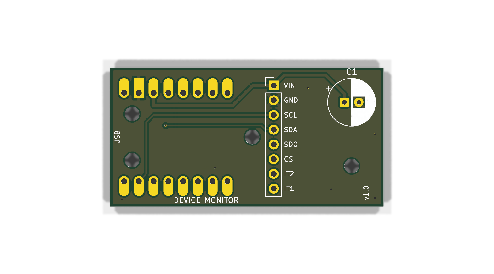
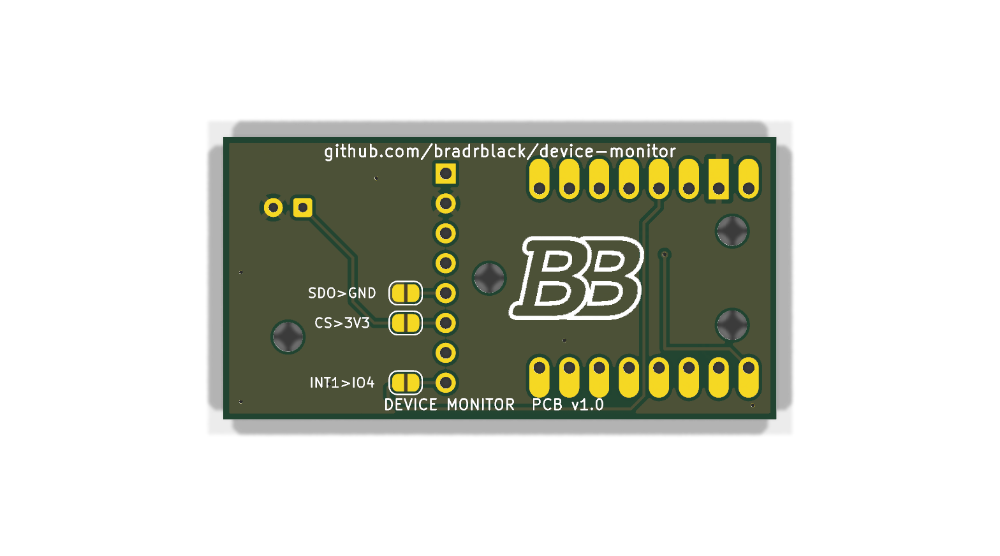

# Device Monitor carrier PCB (v1.0)

A small 2-layer carrier that holds an **ESP32-C3 SuperMini** and a **GY-346
(ADXL346) accelerometer module**, plus one bulk capacitor. It is a cut-down of the
[Sump Master 2000](https://github.com/bradrblack/sump-master-2000) carrier: the
ESP32, the accelerometer socket, the I2C wiring and three of the case-pin holes are in
exactly the same places. The AHT20 and the ultrasonic sensor are gone, and the board
stops right after the capacitor.

 

Only the ADXL346 is supported on this board. The older ADXL345 breakouts have a
different pinout, so they don't fit this socket. Wire one by hand instead (see
"Wiring" in the main README).

## Files

| File | What it is |
|---|---|
| `tools/gen_carrier.py` | Generates the schematic and the placed, routed board. **Edit its tables and re-run it** instead of hand-editing the outputs |
| `devmon_carrier.kicad_pro/.kicad_sch/.kicad_pcb` | KiCad 10 project |
| `devmon_carrier-schematic.pdf` | Schematic |
| `devmon_carrier-bom.csv` | BOM exported from the schematic |
| `devmon_carrier-v1.0-gerbers.zip` | Gerbers and drill files, ready to upload to a PCB fab (`gerbers/` has the same files unzipped) |
| `carrier-top.png`, `carrier-bottom.png` | Renders |
| `Custom_Library.*` | SuperMini footprint/symbol and the 2.5 mm case-pin hole (copied from sm2k) |

To regenerate and check the board, run one of these from the repo root:

```sh
# macOS with KiCad 10 installed
/Applications/KiCad/KiCad.app/Contents/Frameworks/Python.framework/Versions/Current/bin/python3 hw/tools/gen_carrier.py
# anywhere with Docker
docker run --rm -v "$PWD":/w -w /w kicad/kicad:10.0 python3 hw/tools/gen_carrier.py
```

Then run `kicad-cli sch erc hw/devmon_carrier.kicad_sch` and
`kicad-cli pcb drc --schematic-parity hw/devmon_carrier.kicad_pcb`. v1.0 gives 0 ERC
and 0 DRC violations with KiCad 10.0.8. The zone fill is done by the script, so open
the board and press **B** before you plot it yourself.

## Board facts

- **47.0 x 24.0 mm**, 1.6 mm FR-4, 2 layers, GND pour on both sides.
- 0.2 mm minimum track and clearance, 0.3 mm vias, 0.5 mm copper-to-edge. Any basic
  2-layer order works (JLCPCB, PCBWay, OSH Park).
- Everything you solder is through-hole. The three solder jumpers on the bottom are
  bare pads, not parts.

## Schematic

| Net | ESP32-C3 SuperMini | J1 (GY-346 header) | Notes |
|---|---|---|---|
| 3V3 | 3V3 (pin 3) | 1 VIN | plus C1 + |
| GND | GND (pin 2) | 2 GND | plus C1 - |
| SCL | GPIO 6 | 3 SCL | the module has its own pull-ups; firmware runs 100 kHz |
| SDA | GPIO 5 | 4 SDA | |
| ADXL SDO | | 5 SDO | to GND via **JP3** (open) |
| ADXL CS | | 6 CS | to 3V3 via **JP2** (open) |
| | | 7 INT2 | not connected |
| INT1 | GPIO 4 | 8 INT1 | via **JP1** (open) |

- The status LED is the SuperMini's own LED on GPIO 8. Nothing on the carrier
  touches GPIO 2, 8 or 9 (the strapping pins).
- **C1 is optional.** It is a 100-470 uF electrolytic across 3V3/GND right next to
  the accelerometer. The original device-monitor ran without one. On the sm2k bench,
  though, bulk caps at the sensors were what made the I2C bus reliable, so fit one if
  the accelerometer ever drops out.
- **The solder jumpers all ship open.** With all three open, the board matches the
  sm2k setup, which is known to work (the GY-346's own resistors put it in I2C mode at
  address 0x53).
  - **JP2 (CS>3V3)** and **JP3 (SDO>GND)**: bridge both if the accelerometer drops
    off the bus. They tie the module's mode pins hard instead of relying on its
    pull resistors.
  - **JP1 (INT1>IO4)**: connects the ADXL's INT1 output to GPIO 4. Current firmware
    doesn't use it. It's there for a future interrupt or deep-sleep wake.

## BOM

| Ref | Qty | Part | Notes |
|---|---|---|---|
| U1 | 1 | ESP32-C3 SuperMini | The external-antenna "v2" or the plain one both fit. Solder it with its USB-C facing the "USB" edge, parts side up |
| - | 2 | 1x8 male pin header, 2.54 mm | Usually supplied with the SuperMini |
| J1 | 1 | GY-346 (ADXL346) module, 20 x 9 mm | Solder it on its own 1x8 male header (2.5 mm plastic spacer) |
| C1 | 0-1 | **Optional:** 100-470 uF, 6.3 V or higher, radial electrolytic | 2.5 mm lead pitch, at most 8 mm diameter and 12.5 mm tall (the case allows this). 470 uF 10 V 8x12 or 220 uF 6.3x11 are typical |
| PCB | 1 | This board | Gerber zip above |

## Assembly

1. **Test the GY-346 first.** Connect it to the SuperMini on Dupont wires
   (VIN-3V3, GND-GND, SCL-GPIO6, SDA-GPIO5), flash the firmware and check that the
   accelerometer is detected. Desoldering an 8-pin module afterwards is a pain.
2. **C1 (optional):** long lead (+) into the **square** pad (marked +). Push it flat to the board.
3. **ESP32 SuperMini:** put both 1x8 male headers into the carrier (short pins down),
   lay the SuperMini on top with **USB-C over the "USB" edge** and solder the top
   side, then flip it and solder the bottom. The USB-C connector overhangs the board
   edge; that's intended, because the case's end wall clamps it.
4. **GY-346:** solder its 1x8 header into J1 so that **pin 1 = VIN** is next to the
   square pad (the silk labels VIN ... IT1 must match the module's own labels). The
   module lies flat **toward the capacitor**, its board 2.5 mm above the carrier.
5. Trim every lead on the bottom to about 1.5 mm. The case's standoffs and pins sit
   under the four holes.
6. Leave JP1-JP3 open unless you need them (see above).
7. Plug in USB, flash, and follow the first-boot steps in the main README.

## Dimensions for the case

Coordinates are in mm, measured from the board's **top-left corner** (the USB end),
with **x along the board** away from the USB end and **y down** (KiCad's convention),
looking at the **top (component) side**. They are the same coordinates as the sm2k
carrier.

| Item | Position / size | Notes |
|---|---|---|
| Board outline | 0..47.0 x 0..24.0, 1.6 thick | square corners |
| H5, H6 | (3.75, 8.0), (3.75, 16.0), 2.5 mm NPTH | under the ESP at the USB end, floor pins only |
| H1 | (24.4, 12.0), 2.5 mm NPTH | between ESP and GY-346, which leaves room for a 3.4 mm post (ESP edge x 22.5, GY-346 edge x 26.83) |
| H2 | (41.5, 17.0), 2.5 mm NPTH | far end; nothing within 5.6 mm, so a 4.5 mm hook post fits |
| ESP32-C3 SuperMini | x 0..22.5, y 3..21 | module PCB top 3.74 above the carrier top (2.54 header + 1.2 PCB) |
| USB-C | centred on y 12.0, overhangs x = 0 | about 9 x 3.2 mm, bottom flush with the module PCB top |
| RESET button | (9.0, 8.0) | on the SuperMini, measured on sm2k |
| J1 pins | x 28.1, y 3.11..20.89 (2.54 pitch) | |
| GY-346 module | x 26.83..35.83, y 2.0..22.0 | its board 2.5 mm above the carrier top, about 5.5 mm to its tallest part |
| C1 | centre (41.5, 6.0), leads (40.25, 6.0) + and (42.75, 6.0) | up to 8 mm dia x 12.5 mm above the carrier top |
| Bottom side | THT tails: U1 rows y 4.38 and 19.62 (x 2.36..20.14), J1 column x 28.1, C1 leads | flat solder jumpers at x 30.85..32.15, y 13.27 / 15.81 / 20.89. No tail is within 3.9 mm of any hole |

## Differences from the sm2k carrier

- 47 mm long instead of 75.5. No AHT20 (J2), no SR04 lead pads (J3), no second cap.
- H3 and H4 (under the sm2k's SR04) are gone. H2 moved to the far end at (41.5, 17.0).
- GPIO 4 now goes to the ADXL's INT1 through JP1. On sm2k it was the SR04 Echo, and
  GPIO 3 (Trig) is unused.
- New bottom-side solder jumpers JP1-JP3.
- Cap footprint is D8.0 (sm2k: D7.5), so an 8 mm 470 uF part fits too.
