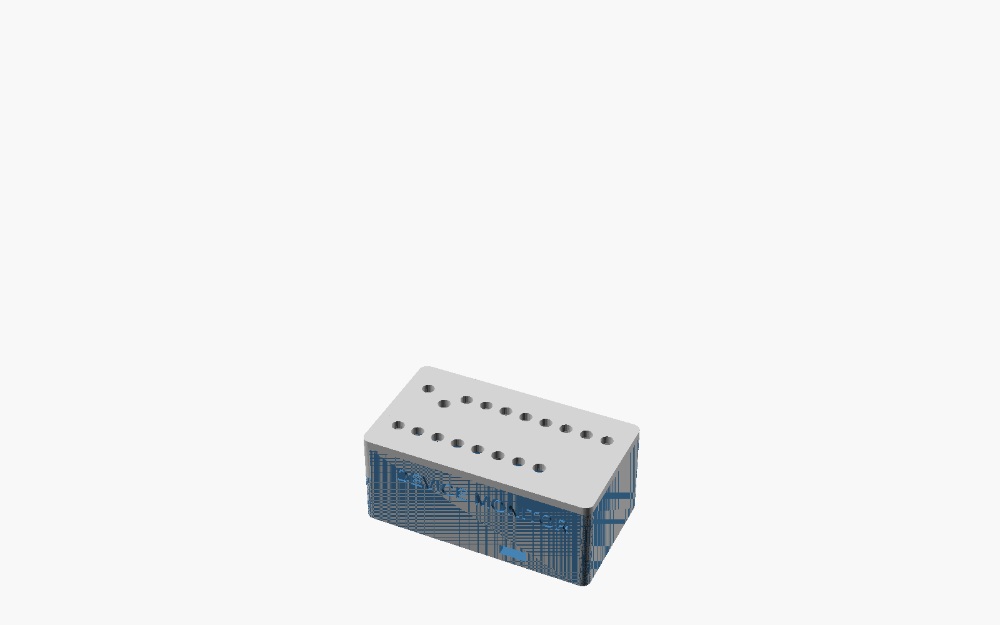
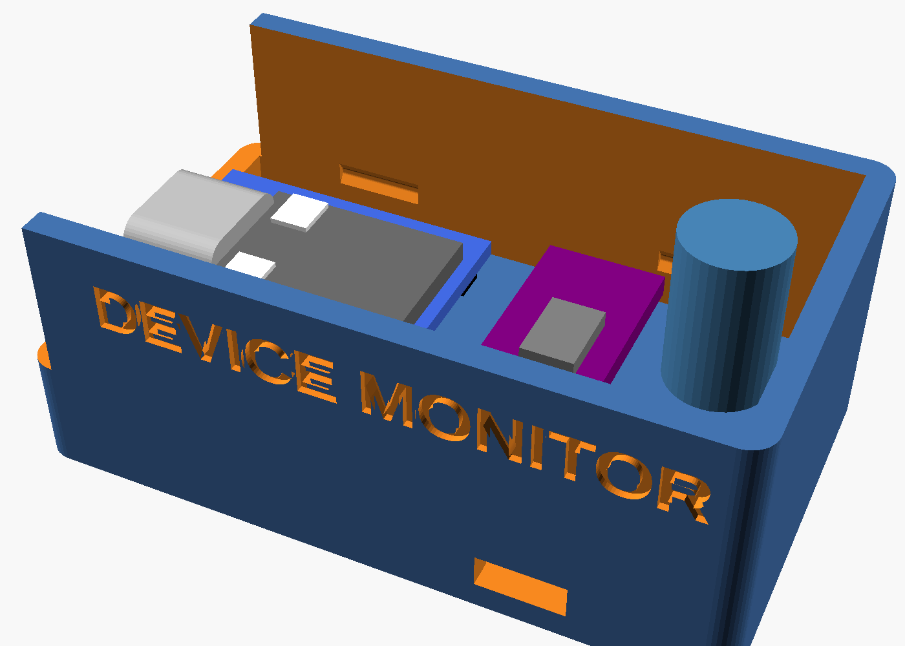
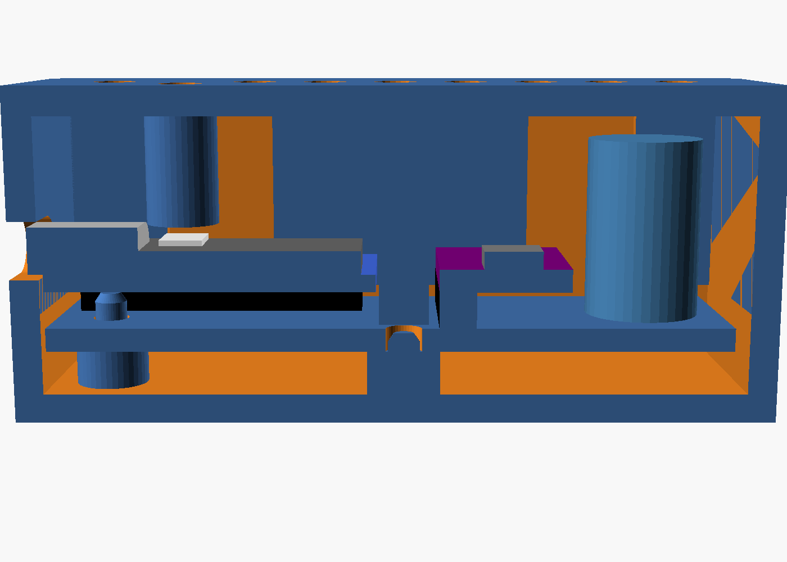
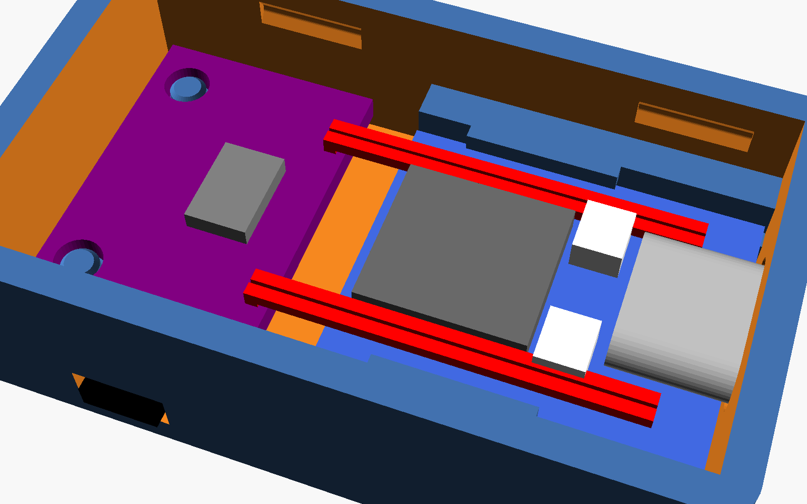
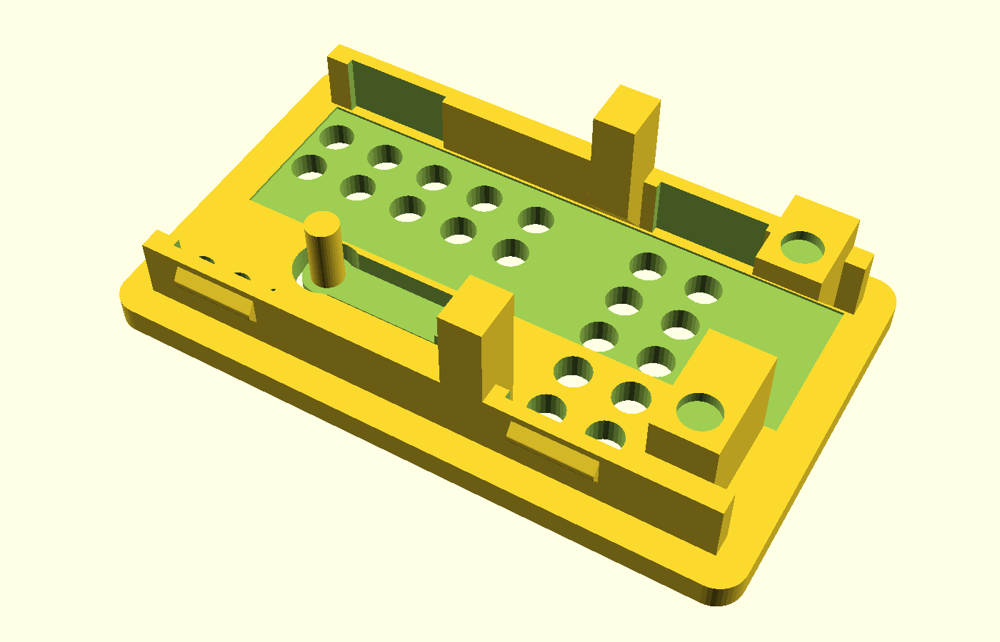
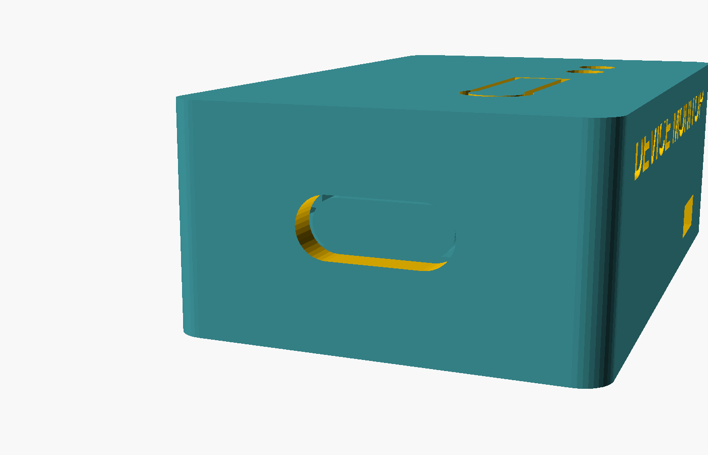
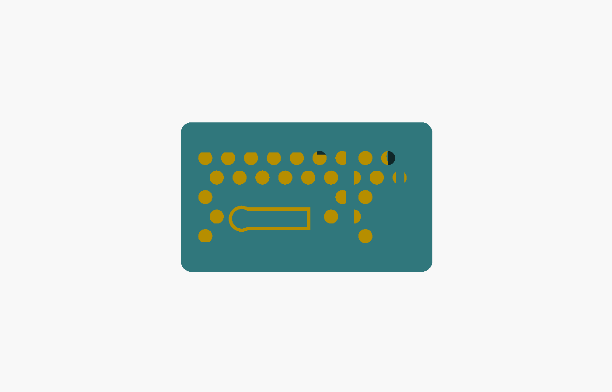

# Device Monitor case

 

A two-part printed case (tray + lid) for the device monitor carrier PCB
(`../devmon_carrier.kicad_pcb`: ESP32-C3 SuperMini, GY-346 / ADXL346 module and one
bulk capacitor). Outside it is **55.8 x 31 x 23 mm**. The case is the same whether or not C1 is fitted
(the board works without it; it can be added later if needed).

| File | What it is |
|---|---|
| `device_monitor_case.scad` | The OpenSCAD source. Everything is a parameter at the top. |
| `tray.stl`, `lid.stl` | Ready to print. The lid is exported upside down (ceiling on the bed). |
| `check_case.sh` | Renders the clash checks: lid against tray, and each against the board and its parts. Run it after any change. |
| `case-*.png` | Renders: closed, carrier in the tray, the lid from inside, a section. |

It is built from the author's two earlier cases:

- From the **RF ceiling fan remote** case
  ([fan_dongle_case.scad](https://github.com/bradrblack/rf-ceiling-fan-remote/blob/main/hw/case/fan_dongle_case.scad)):
  no screws. Printed standoffs with pins go through the carrier's holes, and caps
  (hook posts) hang from the lid to clamp the board. A guide tube hangs over the
  RESET button for a paperclip. The USB and RESET positions are the same as on that
  case (same SuperMini footprint and position).
- From **Sump Master 2000**
  ([sump_case.scad](https://github.com/bradrblack/sump-master-2000/blob/main/hw/case/sump_case.scad)):
  the USB-C opening split between tray and lid (the tray's stub wall holds the lower
  half, the lid's end wall the upper half, so the board drops straight in), and the
  wedge-and-divot closure in place of a friction fit. The lid has two skirts that
  slide down inside the tray's walls. Each skirt is thinned to 1 mm at two pockets, and
  a rounded wedge on each pocket clicks into a divot in the tray wall. Closed,
  nothing is under load (0.1 mm clearance), so the fit doesn't creep loose.



## How the board is held

| Hole (KiCad x, y) | Tray | Lid |
|---|---|---|
| H5 (3.75, 8), H6 (3.75, 16) | standoff + pin | nothing (the ESP module is above them); these take the USB plug's push |
| H1 (24.4, 12) | standoff + short pin, stopping inside the hole | solid 3.4 mm post pressing on the board around the hole (too tight between the ESP and J1 for a hollow cap) |
| H2 (45.3, 17.5) | standoff + pin | hollow 4.5 mm cap over the pin, 0.3 mm above the board |

The board sits on 3 mm standoffs, so its solder tails clear the floor. Once closed, the
H1 post and H2 cap hold the board down against its standoffs, so the accelerometer is
coupled to the case.

## Printing

- PLA or PETG, 0.2 mm layers, 3 walls, no supports.
- **Tray:** floor on the bed. **Lid:** as exported, ceiling on the bed, skirts and posts
  pointing up.
- Test the fit before using the case: the wedge (`detent`, 0.4 mm) and the pins
  (`pin_d`, 2.2 mm in 2.5 mm holes) are the values to adjust. If the lid clicks too
  hard, lower `detent` to 0.3. If it falls off, raise it to 0.5.
- A light-coloured lid lets the onboard status LED show through the vent holes.

## Assembly

1. Drop the carrier onto the tray's pins. Its USB-C connector settles into the lower half
   of the port in the tray's end wall.
2. Push the lid straight down until all four wedges click. Its end wall closes over the
   top of the connector.

To open it, pull the tray and lid apart firmly. The 35-degree wedge flanks let go
without tools.

**Reset:** push a paperclip or toothpick straight down through the hole near the USB end.
It lands on the SuperMini's RESET button (pressing it twice reopens the Wi-Fi setup
portal; see the main README).

## Antenna

The SuperMini v2's external ribbon antenna (about 40 x 11 mm) sticks flat to the inside of
the lid's skirt on the side away from the capacitor (the side with the label on the tray),
up against the ceiling. Stick it on before closing the case and route the cable to the
module's u.FL connector. The clash check includes it there.

## Mounting

The underside is flat, so it couples well to whatever it sits on. Use VHB tape on a
washer, dryer or AC cabinet. For a pipe, such as a sump pump discharge, thread one zip tie
(up to 5.5 x 2 mm) through the slot at floor level. It crosses the floor under the
carrier, where the board has no solder tails, and comes out the other side. Set
`strap = false` for a case without the slot.

## Changing it

The board numbers (`pcb_l`, `holes`, part positions and heights) are copied from
`../tools/gen_carrier.py`. If the board changes, update them and run:

```
./check_case.sh                    # each line must say ok
openscad --export-format binstl -o tray.stl -D 'part="tray"' device_monitor_case.scad
openscad --export-format binstl -o lid.stl  -D 'part="lid"'  device_monitor_case.scad
```

The cavity height follows the tallest part, the 12.5 mm capacitor (`cap_h`). `part="section"` and
`part="fit"` are useful previews.

## Slide-in case (no carrier PCB)

`slide_in_case.scad` is a smaller case for building a monitor without the carrier
board: **46.2 x 27.6 x 15 mm** outside, against 56 x 31 x 23 for the PCB case. The
ESP32-C3 SuperMini and the GY-346 are joined by four wires soldered straight to the
pads, with no headers.

   

| Wire | SuperMini pad | GY-346 pad |
|---|---|---|
| power | 3V3 | VIN |
| ground | GND | GND |
| SDA | 5 | SDA |
| SCL | 6 | SCL |

Leave CS and SDO open, as on the carrier with its jumpers open. About 35 mm of thin
wire each (26-30 AWG).

**How it holds the parts**

- The SuperMini rides on two side ledges under its long edges. A lip over its edges
  toward the back stops it lifting, and its USB-C sits in a hole in the end wall.
  The lip stays clear of the front 9.5 mm, where the wires are soldered.
- Two posts on the lid drop in behind the SuperMini's rear corners. Pushing a cable
  in pushes the board back into them, and pulling a cable out pulls it forward
  against the end wall. The wires run back between the posts.
- The GY-346 sits on two floor rails with its header pads toward the SuperMini. Two
  pins come up through its mounting holes, and two lid feet press the board down
  around the holes. A firm clamp matters here, because a loose module reads its own
  rattle as vibration.
- The ribbon antenna sticks to the ceiling in a shallow recess down the lid's centre.
  The reset tab, the posts and the feet all stay out of that strip.
- **USB-C:** the end wall has a stadium-shaped hole 10 x 4 mm. The SuperMini slides
  forward until its USB-C receptacle sits in the hole, about 1 mm back from the outside
  face, so a cable plugs straight in.
- **RESET:** a flex tab is cut into the lid over the button (the keyhole shape), with a
  plunger under its round end. Press the tab to reset; a double press reopens the Wi-Fi
  portal. BOOT has no tab, since flashing over USB doesn't need it.
- The lid has a staggered grid of 2.6 mm vent holes (the LED shows through), kept
  clear of the reset tab and the post and foot roots. There is no label on the sides.
- The lid clicks on with the same skirts, wedges and divots as the PCB case. There is
  also a slot for a 4.8 mm zip tie under the module.

**Assembly**

1. Solder the four wires, then test the module on the bench (first-boot steps in the
   main README).
2. Lower the SuperMini into the back half of the tray, USB-C forward, and set its front
   edge on the ledges just behind the lip. Its rear end rests on the module's two
   locating pins, so it tilts about 2 degrees. Slide it forward: it levels out under the
   lip, and the USB-C ends up in the end-wall hole.
3. Drop the GY-346 onto its two pins, components up.
4. Stick the antenna into the lid's recess, then press the lid down until it clicks.

**Measure before you print.** Some sizes are still estimates. Change the values at
the top of the file, then run `./check_case.sh slide_in_case.scad` (all three checks
must say ok):

- `esp_t`: the SuperMini's bare PCB thickness. It is assumed to be 1.0 mm.
- `gy_hole_d` and `gy_hole_in`: the GY-346 hole diameter and the distance from each
  hole's centre to the module's edge. They are estimated at 3.0 and 2.5 mm from a
  photo.
- `btn_from_front` and `btn_from_edge`: the RESET button position, taken from the sm2k
  measurement.

Print the tray and lid as `slide_tray.stl` and `slide_lid.stl`, using the same
settings as the PCB case.
