# Device Monitor cases

There are two printed cases. Both are a tray and a lid that click together with no
screws, and both clamp the accelerometer firmly so it feels the machine's vibration.

| | Slide-in case (recommended) | PCB case |
|---|---|---|
| Source | `slide_in_case.scad` | `device_monitor_case.scad` |
| Print | `slide_tray.stl`, `slide_lid.stl` | `tray.stl`, `lid.stl` |
| Outside | 57.8 x 27.6 x 15 mm | 55.8 x 31 x 17 mm |
| Electronics | SuperMini + GY-346, 4 wires soldered direct | SuperMini + GY-346 on the [carrier PCB](../PCB.md), without the optional capacitor C1 |
| Parts held by | wall grooves, lid posts, floor rails and pins | printed pins through the PCB's holes, lid posts |
| RESET | flex tab in the lid | the same flex tab |
| Antenna | lid ceiling, in a recess | the same |
| Antenna cable | wound once round two posts under the lid | wound three times round one post under the lid |
| Vents | 2.6 mm holes: a grid in the lid, a row of 5 in each long wall | the same |
| Status LED | through the reset tab's outline (thin lid) and the vents | the same |
| Zip-tie slot | 4.8 mm | 5.5 mm |
| Magnet mount | optional: 4 x 10 x 3 mm magnets in the floor, 1.8 mm taller ([below](#magnet-mount)) | no |

The two cases share the lid design: the snap closure, the reset tab, the vent holes,
and the antenna recess are the same in both, and both lids have posts to wind the cable round. The slide-in case needs
no PCB order, only four short wires. The PCB case needs no wiring at all: the modules
solder to the carrier and the carrier drops onto pins.

### Antenna cable

The antenna's cable is about 120 mm long, far more than the case needs. Both lids
have 7 mm posts with flared feet at the far end from the USB-C to wind the slack
round. The posts are fat so the thin coax bends at about 4 mm radius. Either way
about 50 mm stays free to reach the SuperMini's u.FL connector, which is enough to
lay the open lid beside the tray, with no loose loop to trap when you close it.

- **Slide-in case:** two posts. Wind the cable **once** round the pair (about
  46 mm). `cable_posts = false` in `slide_in_case.scad` gives the older short case
  (46.2 mm) without the posts.
- **PCB case:** one post (H2's cap), so the capacitor's footprint beside it stays
  clear. Wind the cable **three times** round it (about 26 mm a turn).

## Slide-in case

`slide_in_case.scad` builds a monitor without the carrier board: **57.8 x 27.6 x
15 mm** outside. The ESP32-C3 SuperMini and the GY-346 are joined by four wires
soldered straight to the pads, with no headers.

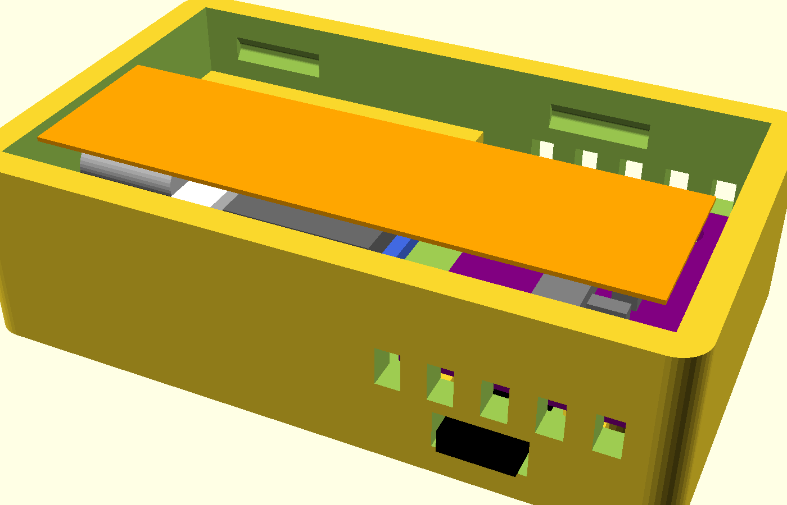 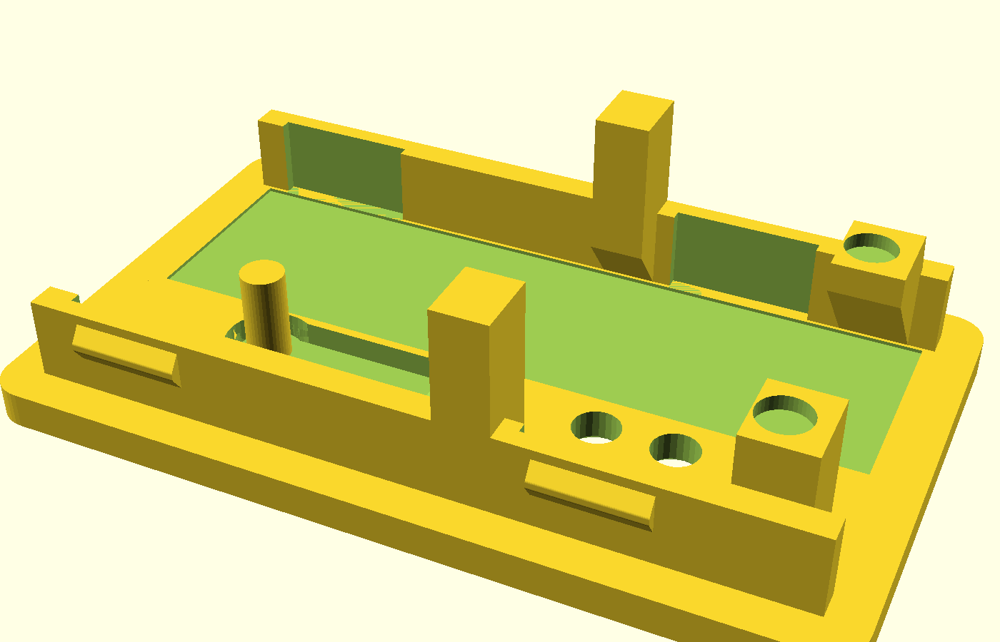
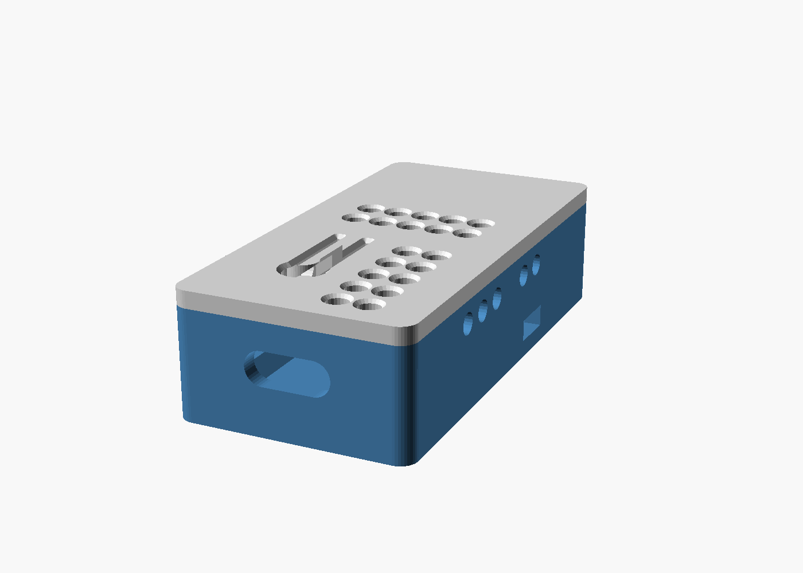 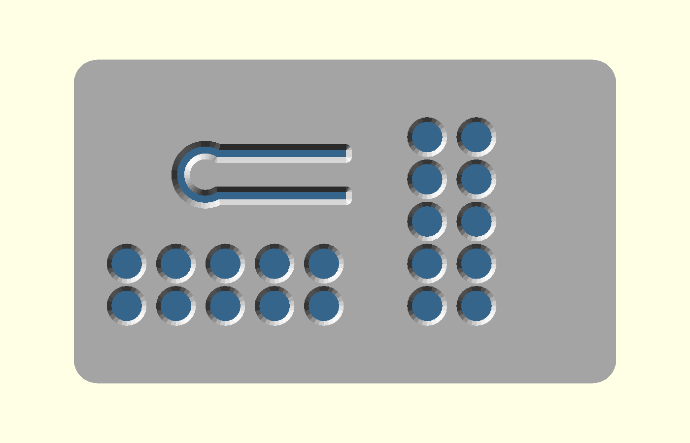
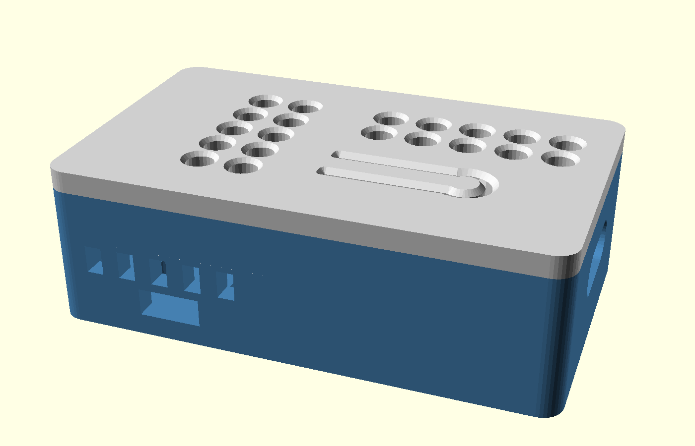

| Wire | SuperMini pad | GY-346 pad |
|---|---|---|
| power | 3V3 | VIN |
| ground | GND | GND |
| SDA | 5 | SDA |
| SCL | 6 | SCL |

Leave CS and SDO open, as on the carrier with its jumpers open. About 35 mm of thin
wire each (26-30 AWG).

### How it holds the parts

- The SuperMini rides on two side ledges under its long edges. A lip over its edges
  toward the back stops it lifting, and its USB-C sits in a hole in the end wall.
  The lip stays clear of the front 9.5 mm, where the wires are soldered.
- Two posts on the lid drop in behind the SuperMini's rear corners. Pushing a cable
  in pushes the board back into them, and pulling a cable out pulls it forward
  against the end wall. The wires run back between the posts. The posts are 5 mm
  deep, and each one's tip drops in front of a low stop on the tray floor (1.3 mm
  high, joined to the GY-346's front rail, under the module's edge), so the push of
  a cable goes into the tray. The first print had 3 mm posts hanging free, and both
  snapped off at the lid.

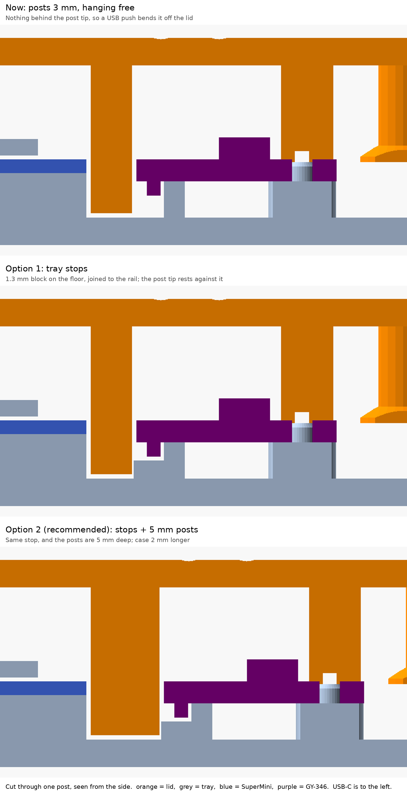
- The GY-346 sits on two floor rails with its header pads toward the SuperMini. Two
  pins come up through its mounting holes, and two small lid feet press the board
  down around the holes. A firm clamp matters here, because a loose module reads its
  own rattle as vibration. The feet stay on the bare board between each hole and the
  module's edges, clear of the regulator, the 0805 parts and the big cap; the
  module's parts are in the clash check (`gy_parts` in the scad, measured from a
  photo of the board).

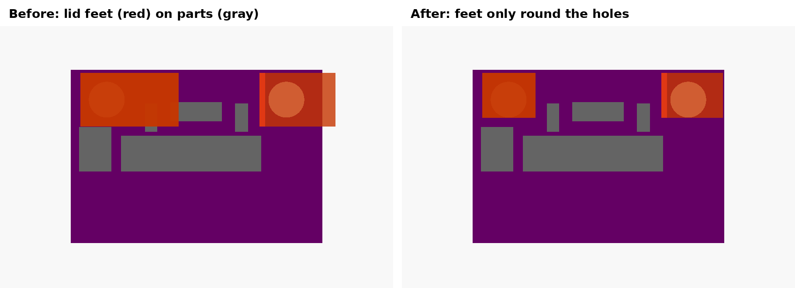
- The ribbon antenna sticks to the ceiling in a shallow recess down the lid's centre.
  The reset tab, the posts and the feet all stay out of that strip. Its cable winds
  round the two posts past the module (see [Antenna cable](#antenna-cable)).
- **USB-C:** the end wall has a stadium-shaped hole 10 x 4 mm. The SuperMini slides
  forward until its USB-C receptacle sits in the hole, about 1 mm back from the outside
  face, so a cable plugs straight in.
- **RESET:** a flex tab is cut into the lid over the button (the keyhole shape), with a
  plunger under its round end. It sits over RESET as on the carrier: 9 mm from the USB
  end, on the far side when you look down with the USB-C pointing left. Press the tab to reset; a double press reopens the Wi-Fi
  portal. BOOT has no tab, since flashing over USB doesn't need it.
- The lid has a grid of 2.6 mm vent holes (one block over the SuperMini, one over the
  module), kept clear of the reset tab and the post and foot roots; the antenna shows
  through the middle rows (`vents_over_antenna = false` drops those). The tab's cut
  and the holes are chamfered on the top face, so the first layers (the lid prints
  top down) don't squash them shut. Each long wall has a row of five round holes
  the same size, through the tray wall and the lid skirt behind it, between the
  snaps (the row skips the lid post). There is no LED row (`led_row = true`
  brings back 2 mm holes along the SuperMini's RESET-side edge) and no label on the
  sides.
- The lid clicks on with the same skirts, wedges and divots as the PCB case. There is
  also a slot for a 4.8 mm zip tie under the module.

### Assembly

1. Solder the four wires, then test the module on the bench (first-boot steps in the
   main README).
2. Lower the SuperMini into the back half of the tray, USB-C forward, and set its front
   edge on the ledges just behind the lip. Its rear end rests on the module's two
   locating pins, so it tilts about 2 degrees. Slide it forward: it levels out under the
   lip, and the USB-C ends up in the end-wall hole.
3. Drop the GY-346 onto its two pins, components up.
4. Stick the antenna into the lid's recess, wind its cable once round the two posts
   and plug it into the SuperMini. Then press the lid down until it clicks.

### Measurements

The sizes come from measured parts (2026-11-14, SuperMini and RESET re-measured 2026-11-22): SuperMini 22.7 x 17.7 x 1.0 mm bare
PCB, GY-346 holes 3.0 mm across, 15 mm apart, centres 2.5 mm from the edge opposite
the pins. The RESET position (`btn_from_front`, `btn_from_edge`: 8.8 and 5.9 mm to its centre) is Brad's
measurement. Clones vary, so if yours differ, change the values at the top of
`slide_in_case.scad` and run `./check_case.sh slide_in_case.scad` (all three checks
must say ok) before re-exporting.

### Mounting

Same as the PCB case: VHB tape on a flat panel, or a zip tie (up to 4.8 x 2 mm)
through the slot under the module for a pipe. See [Mounting](#mounting) below.

### Magnet mount

For freezers, dryers, AC units and anything else with a steel panel, the tray can
hold four 10 mm x 3 mm neodymium disc magnets in its floor. Print
`slide_tray_magnets.stl` (or set `magnets = true` at the top of
`slide_in_case.scad`) with the normal `slide_lid.stl`. The floor grows from 2 to
3.8 mm, so the case is **57.8 x 27.6 x 16.8 mm**: 1.8 mm taller, same footprint.

The pockets open into the cavity: two on the centre line under the SuperMini, two
across the far end behind the GY-346, each with 0.6 mm of floor under it.

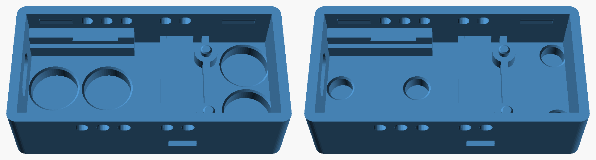 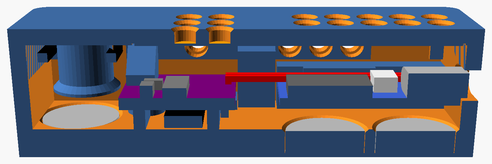
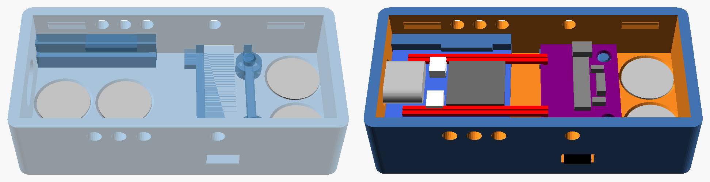

**No glue needed.** The 0.6 mm floor skin sits between each magnet and the steel,
so pulling the case off the steel lifts the skin, which lifts the magnet with it.
Nothing can pull a magnet out. (Pockets in the underside would be the other way
round: the magnet stays on the steel as the case comes away, so only glue would hold
it, and a label over it won't.) The skin costs some grip, very roughly half of a
bare magnet's pull, but four 10 x 3 mm magnets still hold far more than the
monitor weighs, also on a vertical panel.

**Fitting.** Pockets are 10.15 mm across (`mag_hole_d`) and 3.2 mm deep, with a
small lead-in round the mouth: a firm press fit for a 10.0 mm magnet on most
printers. Press each one in with a flat non-magnetic tool (a pencil end) before the
electronics go in; keep the other magnets well away, or they jump. Any pole up
works. If a magnet is loose, a drop of CA glue fixes it; if they won't go in, set
`mag_hole_d = 10.3`. The magnets end 0.2 mm below the floor's top, so nothing stands
proud under the parts. The bottom of the case stays solid and flat for the QR label,
and the zip-tie slot still works.

**Printing.** As the plain tray, floor down, no supports.

**Wi-Fi near steel.** A steel panel under the case reflects and detunes the
antenna. The ribbon antenna is on the lid ceiling, the part of the case furthest
from the steel (about 15 mm), which is about as good as a case this size gets.
Mount it on the outside of the cabinet, lid facing out, and not behind a steel door
or inside a metal housing. If the signal reading on the web page drops a lot after
mounting, try a spot near the cabinet's edge or a side panel facing the router.

### Printing

Print `slide_tray.stl` floor down and `slide_lid.stl` as exported (ceiling on the
bed): PLA or PETG, 0.2 mm layers, 3 walls, no supports. A light-coloured lid lets the
LED glow through the thin lid and the tab's outline. To re-export after a change:

```
./check_case.sh slide_in_case.scad      # each line must say ok
openscad --export-format binstl -o slide_tray.stl -D 'part="tray"' slide_in_case.scad
openscad --export-format binstl -o slide_lid.stl  -D 'part="lid"'  slide_in_case.scad
# magnet tray: also run CASE_DEFS="-D magnets=true" ./check_case.sh slide_in_case.scad
openscad --export-format binstl -o slide_tray_magnets.stl -D 'part="tray"' -D magnets=true slide_in_case.scad
```

## PCB case

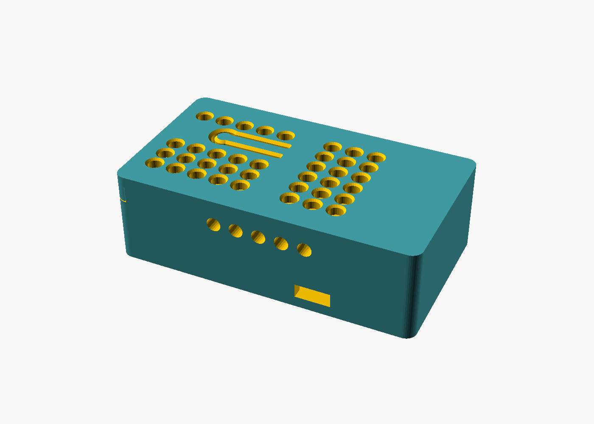 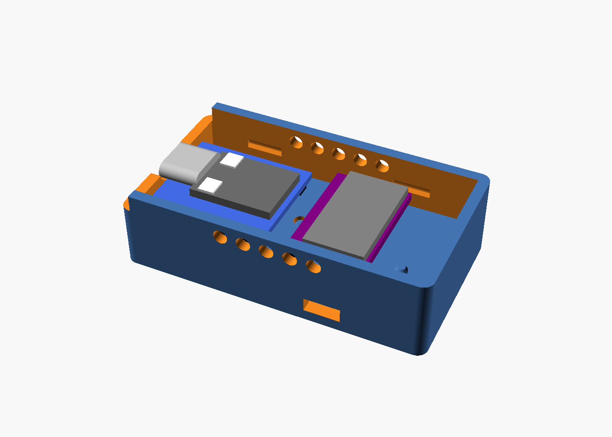

A two-part printed case (tray + lid) for the device monitor carrier PCB
(`../devmon_carrier.kicad_pcb`: ESP32-C3 SuperMini and GY-346 / ADXL346 module).
Outside it is **55.8 x 31 x 17 mm**. The optional capacitor C1 does not fit this
low case: it is too tall for the lid.

**With the capacitor:** print `tray_cap.stl` and `lid_cap.stl` instead (or set
`cap_fitted = true` in the scad). That case is **23 mm tall**. Everything else is the same.

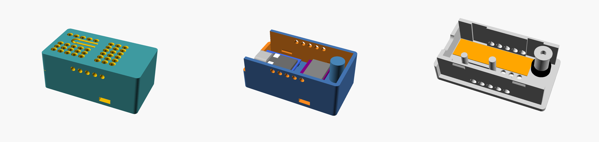

| File | What it is |
|---|---|
| `device_monitor_case.scad` | The OpenSCAD source. Everything is a parameter at the top. |
| `tray.stl`, `lid.stl` | Ready to print. The lid is exported upside down (ceiling on the bed). |
| `check_case.sh` | Renders the clash checks: lid against tray, and each against the board and its parts. Run it after any change. |
| `case-*.png` | Renders: closed, carrier in the tray, the lid from inside, a section. |

It is built from the author's two earlier cases:

- From the **RF ceiling fan remote** case
  ([fan_dongle_case.scad](https://github.com/bradrblack/rf-ceiling-fan-remote/blob/main/hw/case/fan_dongle_case.scad)):
  no screws. Printed standoffs with pins go through the carrier's holes, and caps
  (hook posts) hang from the lid to clamp the board. The USB and RESET positions
  are the same as on that case (same SuperMini footprint and position).
- From **Sump Master 2000**
  ([sump_case.scad](https://github.com/bradrblack/sump-master-2000/blob/main/hw/case/sump_case.scad)):
  the USB-C opening split between tray and lid (the tray's stub wall holds the lower
  half, the lid's end wall the upper half, so the board drops straight in), and the
  wedge-and-divot closure in place of a friction fit. The lid has two skirts that
  slide down inside the tray's walls. Each skirt is thinned to 1 mm at two pockets, and
  a rounded wedge on each pocket clicks into a divot in the tray wall. Closed,
  nothing is under load (0.1 mm clearance), so the fit doesn't creep loose.

- From the **slide-in case** above: the lid top. The reset flex tab, the grid of
  chamfered vent holes, the row of holes in each long wall, the antenna recess under
  the lid and a post to wind the cable round.

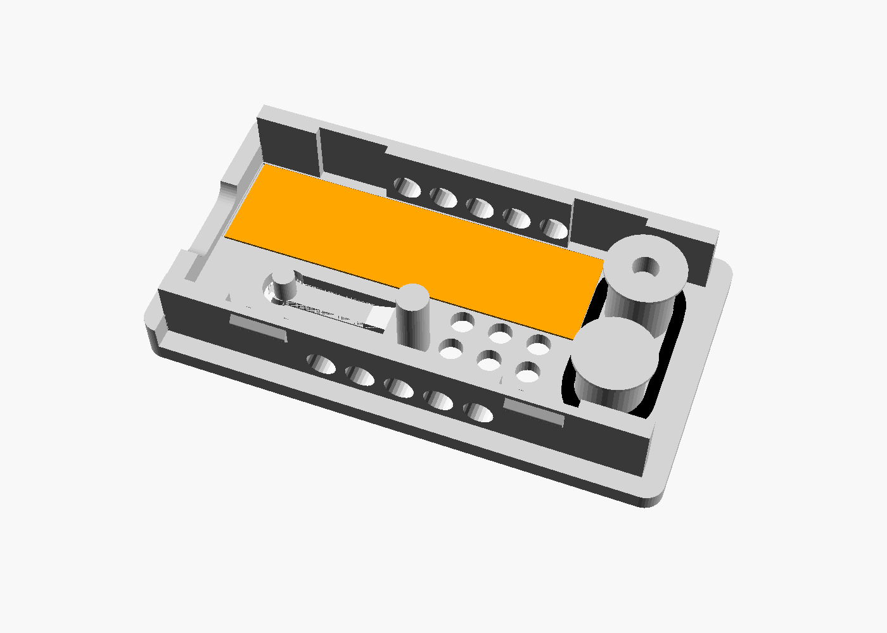 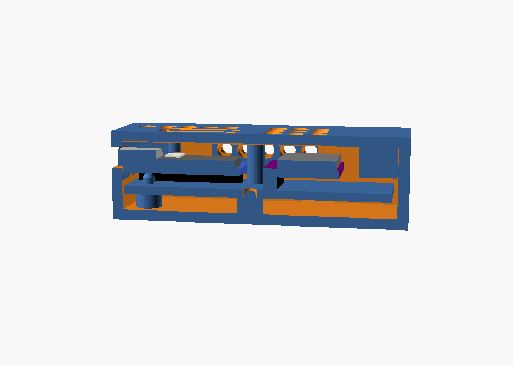

### How the board is held

| Hole (KiCad x, y) | Tray | Lid |
|---|---|---|
| H5 (3.75, 8), H6 (3.75, 16) | standoff + pin | nothing (the ESP module is above them); these take the USB plug's push |
| H1 (24.4, 12) | standoff + short pin, stopping inside the hole | nothing over the hole (the antenna is above it). A solid 3.4 mm post presses on the board 6 mm to the RESET side, at (24.4, 6), on the bare strip between the ESP and J1 |
| H2 (45.3, 17.5) | standoff + pin | hollow 7 mm cap over the pin, 0.3 mm above the board. It is also the cable post |

The board sits on 3 mm standoffs, so its solder tails clear the floor. Once closed, the
press post and the H2 cap hold the board down against its standoffs, so the accelerometer is
coupled to the case.

### Printing

- PLA or PETG, 0.2 mm layers, 3 walls, no supports.
- **Tray:** floor on the bed. **Lid:** as exported, ceiling on the bed, skirts and posts
  pointing up.
- Test the fit before using the case: the wedge (`detent`, 0.4 mm) and the pins
  (`pin_d`, 2.2 mm in 2.5 mm holes) are the values to adjust. If the lid clicks too
  hard, lower `detent` to 0.3. If it falls off, raise it to 0.5.
- A light-coloured lid lets the onboard status LED show through the vent holes.

### Assembly

1. Stick the antenna into the recess under the lid and wind its cable three times
   round the post (see [Antenna cable](#antenna-cable)).
2. Drop the carrier onto the tray's pins. Its USB-C connector settles into the lower half
   of the port in the tray's end wall.
3. Plug the cable into the SuperMini, then push the lid straight down until all four
   wedges click. Its end wall closes over the top of the connector.

To open it, pull the tray and lid apart firmly. The 35-degree wedge flanks let go
without tools.

**Reset:** press the keyhole-shaped tab in the lid near the USB end. A plunger under
it presses the SuperMini's RESET button (pressing it twice reopens the Wi-Fi setup
portal; see the main README).

### Antenna

The SuperMini v2's external ribbon antenna (40 x 11 mm) sticks flat under the lid, in
the shallow recess beside the reset tab, starting at the USB end. The vent holes are
drilled over it too. Its cable winds round the post at the far end. The clash
check includes the antenna and the wound cable.

### Mounting

The underside is flat, so it couples well to whatever it sits on. Use VHB tape on a
washer, dryer or AC cabinet. For a pipe, such as a sump pump discharge, thread one zip tie
(up to 5.5 x 2 mm) through the slot at floor level. It crosses the floor under the
carrier, where the board has no solder tails, and comes out the other side. Set
`strap = false` for a case without the slot.

### Changing it

The board numbers (`pcb_l`, `holes`, part positions and heights) are copied from
`../tools/gen_carrier.py`. If the board changes, update them and run:

```
./check_case.sh                    # each line must say ok
CASE_DEFS="-D cap_fitted=true" ./check_case.sh    # the same for the capacitor version
openscad --export-format binstl -o tray.stl -D 'part="tray"' device_monitor_case.scad
openscad --export-format binstl -o lid.stl  -D 'part="lid"'  device_monitor_case.scad
```

The cavity height follows the tallest part, the SuperMini's USB-C connector. `part="section"` and
`part="fit"` are useful previews.
